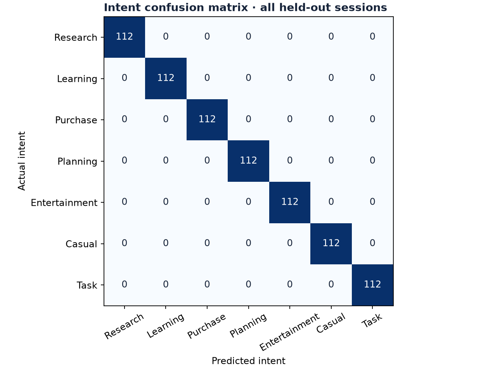
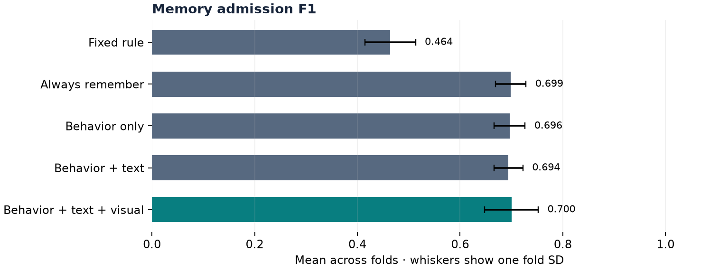
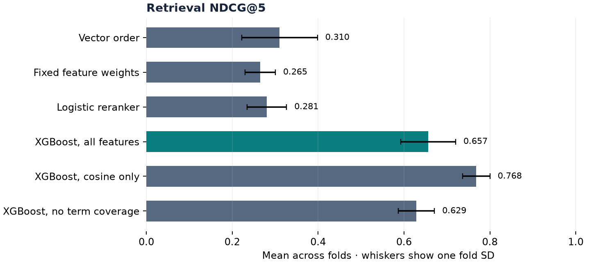

# AIML-EL · Learning What to Remember

## Phase 6 evaluation report

**Evidence source · Synthetic browsing, simulated visual vectors, and scripted relevance.**

AIML-EL uses browsing sessions to predict intent, estimate topic interest,
and decide what to remember. It retrieves up to 20 candidates and reranks
them to five. This benchmark asks how the classifiers, feature families, and
rerankers behave under controlled synthetic conditions.

### What the benchmark found

- Intent classification reached **1.000 macro F1**. The generator
  gives each intent recognizable cues. Replacing those cues with unseen,
  more ambiguous phrases lowered macro F1 to **0.167**.
- Admission F1 was **0.464** for the fixed rule, **0.696**
  for behavior, **0.694** with text, and **0.700** with
  visuals added. Always remembering reaches **0.699** F1 while
  accepting every session. The text variant also uses predicted intent and past topic
  engagement, so its change reflects those features together.
- Full XGBoost reranking reached **0.657 NDCG@5** and vector order
  reached **0.310**. The cosine-only XGBoost ablation scored
  **0.768** and dropping only term coverage gave
  **0.629**. Extra ranking features reduced performance in
  this synthetic comparison. Scripted feedback changed full-ranker NDCG@5 from **0.657** to
  **0.673** and improved 3 of 5 test folds.
- The learned interest model reached **0.195 F1** and the
  exponential-decay baseline reached **0.193**.

### Experimental design

- **Dataset** · 784 sessions from 28 fictional
  participants, seven intent classes, and a binary memory-worthiness label.
- **Validation** · 5 outer participant folds. Each participant appears
  in the test split once. Each fold reserves other participants for validation
  and uses the remainder to fit candidates. Validation selects models and
  thresholds. The test partition scores those choices.
- **Leakage controls** · IDs and timestamps are excluded as direct model
  features. Timestamps order completed activity for interest features. Intent
  features used by admission come from out-of-fold training predictions.
  TF-IDF is fitted only on the training prompt and memory text.
- **Ranking protocol** · 112 held-out synthetic queries.
  Methods share the same 20-item vector candidate pool and rank the same five
  positions. Feedback is drawn from validation prompts with both relevant and
  irrelevant examples. Ablations refit XGBoost using the indicated columns.
  Each prompt has one relevant memory, so P@5 has a maximum of 0.2 here.
- **Reporting** · Tables show the mean and sample standard deviation across
  folds. Variation across folds describes sensitivity to the participant split.

### Intent classification
Intent precision, recall, and F1 are macro-averaged across the seven classes.

Validation scores for the candidate classifiers

| Method | Accuracy | Precision | Recall | F1 |
|---|---:|---:|---:|---:|
| Logistic regression | 1.000 ± 0.000 | 1.000 ± 0.000 | 1.000 ± 0.000 | 1.000 ± 0.000 |
| Random forest | 1.000 ± 0.000 | 1.000 ± 0.000 | 1.000 ± 0.000 | 1.000 ± 0.000 |
| XGBoost classifier | 1.000 ± 0.000 | 1.000 ± 0.000 | 1.000 ± 0.000 | 1.000 ± 0.000 |

Held-out scores for the classifier selected in each fold

| Method | Accuracy | Precision | Recall | F1 | ROC-AUC |
|---|---:|---:|---:|---:|---:|
| Selected classifier | 1.000 ± 0.000 | 1.000 ± 0.000 | 1.000 ± 0.000 | 1.000 ± 0.000 | — |

### Memory admission and interest

| Method | Accuracy | Precision | Recall | F1 | ROC-AUC | Share admitted |
|---|---:|---:|---:|---:|---:|---:|
| Fixed rule | 0.511 ± 0.042 | 0.563 ± 0.044 | 0.395 ± 0.052 | 0.464 ± 0.049 | 0.520 ± 0.036 | 0.376 ± 0.024 |
| Always remember | 0.537 ± 0.035 | 0.537 ± 0.035 | 1.000 ± 0.000 | 0.699 ± 0.030 | 0.500 ± 0.000 | 1.000 ± 0.000 |
| Behavior only | 0.539 ± 0.033 | 0.539 ± 0.034 | 0.987 ± 0.024 | 0.696 ± 0.030 | 0.531 ± 0.054 | 0.984 ± 0.022 |
| Behavior + text | 0.615 ± 0.029 | 0.608 ± 0.038 | 0.821 ± 0.103 | 0.694 ± 0.028 | 0.668 ± 0.061 | 0.732 ± 0.137 |
| Behavior + text + visual | 0.623 ± 0.062 | 0.622 ± 0.078 | 0.835 ± 0.166 | 0.700 ± 0.052 | 0.725 ± 0.046 | 0.734 ± 0.193 |

| Method | Accuracy | Precision | Recall | F1 | ROC-AUC |
|---|---:|---:|---:|---:|---:|
| Exponential decay | 0.775 ± 0.041 | 0.149 ± 0.014 | 0.283 ± 0.057 | 0.193 ± 0.008 | 0.572 ± 0.010 |
| Learned interest | 0.679 ± 0.016 | 0.128 ± 0.008 | 0.409 ± 0.027 | 0.195 ± 0.012 | 0.588 ± 0.012 |

### Retrieval and feedback

| Method | P@5 | R@5 | MRR@5 | NDCG@5 | Candidate recall@20 |
|---|---:|---:|---:|---:|---:|
| Vector order | 0.123 ± 0.036 | 0.615 ± 0.181 | 0.210 ± 0.059 | 0.310 ± 0.088 | 1.000 ± 0.000 |
| Fixed feature weights | 0.087 ± 0.010 | 0.437 ± 0.050 | 0.209 ± 0.039 | 0.265 ± 0.035 | 1.000 ± 0.000 |
| Logistic reranker | 0.099 ± 0.017 | 0.493 ± 0.086 | 0.212 ± 0.037 | 0.281 ± 0.046 | 1.000 ± 0.000 |
| XGBoost, all features | 0.178 ± 0.007 | 0.890 ± 0.037 | 0.578 ± 0.074 | 0.657 ± 0.064 | 1.000 ± 0.000 |
| XGBoost, cosine only | 0.191 ± 0.006 | 0.957 ± 0.030 | 0.705 ± 0.042 | 0.768 ± 0.032 | 1.000 ± 0.000 |
| XGBoost, no term coverage | 0.175 ± 0.015 | 0.875 ± 0.074 | 0.547 ± 0.038 | 0.629 ± 0.042 | 1.000 ± 0.000 |

| Method | P@5 | R@5 | MRR@5 | NDCG@5 | Candidate recall@20 |
|---|---:|---:|---:|---:|---:|
| Before feedback | 0.178 ± 0.007 | 0.890 ± 0.037 | 0.578 ± 0.074 | 0.657 ± 0.064 | 1.000 ± 0.000 |
| After feedback | 0.187 ± 0.006 | 0.935 ± 0.032 | 0.586 ± 0.062 | 0.673 ± 0.052 | 1.000 ± 0.000 |

The scripted feedback used 300 judgments, including
15 useful judgments, across 15 query
groups. This is the generator's label mix. User feedback acceptance and memory
correction rate require judgments from real users.

For the local CPU benchmark, vector candidate selection plus full XGBoost
reranking took 1.26 ms median and 1.42 ms at
the 95th percentile over 112 queries. The timing covers the
in-memory TF-IDF experiment. Live application latency includes storage,
embedding, and request overhead.

### Limitations and next evaluation

The synthetic corpus reuses vocabulary and produces visual embeddings from
known rules. The folds separate fictional users who share that generator.
Real intent ambiguity, screenshot understanding, long-term adaptation, and
feedback quality still need a consented and reviewed real-world dataset.
Future evaluation should label query-to-memory relevance independently and
measure context usefulness and correction rate on unseen participants.

### Reproduce and verify

The command in the repository README regenerates this report, its figures,
the presentation, and the fold-level metrics. Dataset seed is
`42` and the input SHA-256 is
`c0455c40080007cb0458169cd77fa6b6011283382a868835968ef10599cbd1a5`. See [metrics.json](metrics.json) for dependency
versions, participant assignments, test metrics, and the confusion matrix.

### Presentation practice

1. **Why split by participant?** A model can memorize a participant's habits.
   Holding out the entire participant measures transfer to unseen participants.
2. **What does the visual ablation test?** Compare behavior and text to the
   same feature families with simulated vectors added. Compare the F1 and
   ROC-AUC columns before drawing a conclusion about visual features.
3. **What does feedback show?** The loop changes the fitted reranker. Read the
   held-out before/after metrics to judge the effect of these scripted votes.
4. **What is the next real test?** Collect reviewed sessions and relevance
   judgments, reserve participants for evaluation, and rerun the comparisons.
